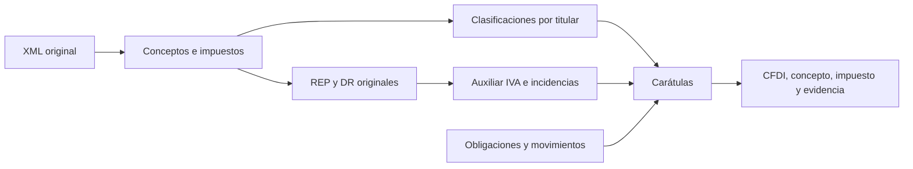

# Reglas de arquitectura — Visor CFDI XML

## Pila establecida

- Java SE 17, Maven, Swing y FlatLaf; **todos los formularios editables con Eclipse WindowBuilder**.
- El layout predeterminado es `javax.swing.GroupLayout` con componentes declarados en campos y constructor público sin parámetros.
- Hibernate ORM + JPA para operaciones transaccionales ordinarias, mapeo de entidades y CRUD.
- JDBC especializado y procedimientos almacenados para consultas extensas, inserciones masivas y otras operaciones donde se justifique por medición o complejidad.
- MySQL 8, esquema de referencia `app/database/schema/visor_cfdi_mysql8_schema_v1.sql`.
- Java controla el alcance de cada transacción, `commit` y `rollback`, tanto en Hibernate como en JDBC.

## Transacciones mixtas Hibernate/JDBC

**Nunca abrir dos conexiones independientes para una operación que debe ser atómica.** Las operaciones que combinen Hibernate y un procedimiento almacenado han de compartir el mismo `EntityManager`, `Session` y conexión JDBC bajo una sola transacción iniciada en Java.

Ejemplo conceptual, cuando exista un procedimiento que ejecutar:

```java
jpa.enTransaccion(em -> {
    em.flush(); // sincroniza cambios JPA anteriores con la conexión
    em.unwrap(org.hibernate.Session.class).doWork(conexion -> {
        try (var sentencia = conexion.prepareCall("{call sp_procesar_lote(?)}")) {
            sentencia.setLong(1, loteId);
            sentencia.execute();
        }
    });
    em.clear(); // si el SP modifica datos que podrían permanecer en el contexto JPA
    return null;
});
```

Se recomienda que los procedimientos utilizados dentro de transacciones Java no ejecuten `COMMIT`, `ROLLBACK`, `START TRANSACTION` ni operaciones DDL con commit implícito. Para procesos masivos, establecer tamaños de lote, verificar índices y medir tiempo, memoria y bloqueos.

## Diseño de dominio

- `view`: exclusivamente componentes, eventos Swing, presentación y validaciones de formulario; no JDBC ni EntityManager.
- `service`: autorización efectiva, reglas de negocio, transacciones y unidades de trabajo.
- `model/entity`: mapeos fieles al esquema, sin código de GUI.
- `model/dto`: datos desacoplados que pueden salir del contexto JPA.
- `persistence`: factoría de entidades y transacciones acotadas.
- Mantener el documento fiscal original separado de ajustes y clasificaciones.
- Conservar XML originales en almacenamiento documental fuera de MySQL.
- El periodo de emisión no es necesariamente el periodo de pago o acreditamiento.

## Seguridad y restricciones actuales

La contraseña MySQL se obtiene automáticamente del almacén local `CredencialesMySqlService`, cifrado mediante AES-256-GCM con una clave aleatoria separada por instalación. Se vincula mediante datos autenticados (AAD) al host, puerto, base y usuario. En POSIX se restringen los permisos a propietario; ambos archivos juntos permiten descifrar el secreto y deben protegerse como credenciales. La contraseña **del usuario de aplicación**, por el contrario, no es reversible: se conserva como hash PBKDF2-HMAC-SHA256 con sal individual y 600 000 iteraciones. Los cambios de cuentas requieren volver a validar el rol ADMIN y quedan en `bitacora_evento`.

**Importante:** los controles de rol implementados en un cliente Swing que se conecta directamente a MySQL no constituyen una barrera de seguridad contra una persona con credenciales de escritura directas a la base. En instalaciones con usuarios no confiables o acceso por Internet será necesario un servicio intermedio que imponga autorización en el servidor, además de TLS y privilegios MySQL mínimos. RF-003 definirá permisos finos por contribuyente y módulo.

Nunca usar `hibernate.hbm2ddl.auto=update`, `create` ni `create-drop` sobre la base del usuario; debe mantenerse `validate`. Los cambios de esquema se versionarán mediante migraciones SQL.

## Arquitectura de la interfaz

Se aplica la guía obligatoria [UI Swing y WindowBuilder](UI-SWING-WINDOWBUILDER.md).
La ventana principal contiene `JMenuBar`, accesos rápidos y un `CardLayout`
central que aloja los catálogos como `JPanel` independientes. Los detalles de
un registro se editan en un único `JDialog` reutilizable para alta y cambio.
No crear ventanas de listado independientes ni ejecutar consultas JPA desde
los constructores visuales.

## Arranque y autenticación MySQL

- RF-001 guarda los parámetros no secretos en `config.properties`; solo después de verificar MySQL guarda la contraseña cifrada de conexión en `database.credentials` y su clave AES en `connection.key`.
- RF-002 inicia `JpaContext` y `UsuariosService` automáticamente desde `Fr_ConexionMySql` mediante `SwingWorker`; solo se pide el secreto cuando no está guardado o cuando el operador lo modifica.
- Cambiar host, puerto, esquema o usuario invalida el descifrado por AAD: nunca reutilizar silenciosamente la clave en otra conexión.
- La contraseña JDBC se entrega a Hibernate como `String` porque el proveedor lo requiere; no puede borrarse inmediatamente de la memoria JVM, aunque los arreglos temporales `char[]` se limpian.
- Conexiones MySQL locales: `sslMode=DISABLED` y `allowPublicKeyRetrieval=true` solo en localhost, 127.0.0.1 y ::1. Limitarlo a loopback es deliberado y no es una configuración apropiada para LAN/Internet.
- Conexiones remotas: `sslMode=VERIFY_IDENTITY`, `allowPublicKeyRetrieval=false`; requiere CA confiable y nombre de servidor verificable.
- Una interrupción del servicio de MySQL no destruye ni reescribe el almacén; se puede reintentar después de iniciar MySQL.

Referencia oficial: MySQL Connector/J Security Properties y MySQL 8 Caching SHA-2 Authentication.

## RBAC configurable (RF-003)

Los permisos se modelan como operaciones atómicas `recurso + accion`
en `permiso`. Se enlazan a los roles a través de `rol_permiso`, y a
usuarios mediante `usuario_rol`. La autorización `AutorizacionService`
consulta la unión de los permisos de los roles vigentes de un usuario
`ACTIVO` **en cada operación sensible**, no únicamente al iniciar sesión.

El catálogo visible de privilegios tiene que corresponder a acciones
realmente implementadas; se debe crear un nuevo permiso a la vez que su
verificación dentro del servicio. Cambios administrativos de roles y
privilegios son transacciones Java y se registran en `bitacora_evento`.

El permiso `ROLES.CONFIGURAR_PERMISOS` es irrenunciable para el rol ADMIN
para evitar bloqueo administrativo. Para conferir el rol ADMIN se requiere
un permiso adicional `USUARIOS.ASIGNAR_ADMIN`. Esta política no reemplaza
la necesidad de autorización en servidor para clientes no confiables.

Referencia: [docs/RF-003.md](RF-003.md).

## Administración multi-contribuyente (RF-004)

El titular fiscal administrado se representa en `contribuyente`, con
historial `contribuyente_regimen` y asignación de operadores
`usuario_contribuyente`. La separación de los terceros ajenos a la
empresa se mantiene en `tercero`.

La autorización tiene dos dimensiones: permiso de operación proveniente
de RF-003 y alcance por contribuyente proveniente de
`usuario_contribuyente`. La asignación global de usuarios
`CONTRIBUYENTES.ASIGNAR_USUARIOS` es una facultad elevada.

La inicialización de `Permisos` conserva los privilegios revocados y
concede solo permisos nuevos a ADMIN, como política obligatoria para las
siguientes ampliaciones del proyecto. Las modificaciones de un
contribuyente o de sus accesos usan Hibernate dentro de una transacción
atómica Java SE, junto con su auditoría; no requieren JDBC masivo.

Más información en [RF-004](RF-004.md).

## Clasificación y auxiliares fiscales del MVP

RF-021 a RF-024 reutilizan el esquema canónico. `cfdi_concepto` y las tablas
de impuestos conservan valores importados; `clasificacion_concepto` y
`clasificacion_impuesto_concepto` guardan decisiones vigentes. Los cambios
anterior/resultante se registran en `bitacora_evento` y `bitacora_cambio`.
No se agrega DDL, ni se materializa un resultado derivado permanente.

`FiscalSql` define un universo acotado por titular, disponibilidad, fecha y
filtros. `partes` da precedencia al detalle por concepto; la categoría general
se hereda sólo sin detalle. Bases e impuestos repartidos son derivados,
truncados a seis decimales con residuo en la última parte. Las consultas
agregan en MySQL antes de paginar y conservan identificadores de origen.

`ResumenClasificacionService` alimenta RF-020 con esa precedencia.
`ImpuestosService` consulta originales por nivel; `ConciliacionPagosService`
compara DR/P/Totales sin mezclarlos. `AuxiliarIvaService` reconoce por
`FechaPago` de REP y `MotorIva` mantiene pendientes de evidencia, tratamiento
o conciliación. `EvidenciaFinancieraService` reutiliza obligación, movimiento,
aplicación y ajuste; la vinculación posterior de un REP añade un enlace, no
un segundo pago. `TercerosFiscalService` reconstruye saldos por fecha y excluye
REP cancelados sin borrar la aplicación histórica.

`CaratulasService` y `ResumenFiscalService` mantienen filas de emisión y
movimientos financieros separadas. No se suman monedas ni dimensiones.
`ImpuestosAgrupadosService` distribuye cada parte original por tratamiento
registrado y remanente pendiente; agrupa por tercero, categoría y firma
tributaria sin multiplicar bases. La carátula IEPS separa fuente CFDI,
fuente DR y ajuste administrativo; no implementa causación definitiva.
Los intervalos de `DATETIME` son fechas civiles: se enlazan como texto ISO
y se convierten en MySQL, sin desplazar medianoche por una diferencia entre
zona de la JVM y `connectionTimeZone=UTC`. La regresión cubre México y UTC.
La UI consume servicios mediante `SwingWorker`, invalida respuestas antiguas
al cambiar filtro o titular y presenta incidencias. La exportación CSV recorre
páginas y revalida permisos; cambios concurrentes entre páginas pueden variar
la instantánea exportada. El motor y sus límites jurídicos se documentan en
[MOTOR-FISCAL.md](MOTOR-FISCAL.md). El diseñador WindowBuilder debe comprobarse
manualmente antes de integrar la PR.


