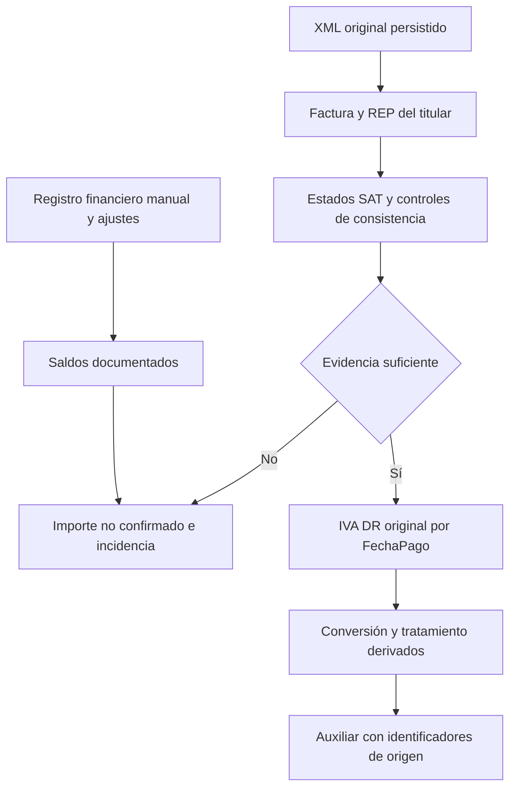

# Motor fiscal — reglas, evidencia y límites

## Estado y finalidad

Documento técnico de RF-021 a RF-024. Los servicios fiscales se encuentran en
validación. Este documento no declara terminada la etapa, aprobadas las pruebas
de integración ni comprobada la compatibilidad del diseñador WindowBuilder.

El sistema produce auxiliares y papeles de trabajo. Conserva separados el XML,
las clasificaciones, las evidencias financieras y los resultados derivados.
Una clasificación `IVA_ACREDITABLE` expresa una decisión registrada por el
usuario; no demuestra por sí sola el cumplimiento de requisitos legales.

## Registro de fuentes oficiales

Consulta realizada el **19 de noviembre de 2026**. Los enlaces vigentes no
constituyen una copia histórica inmutable: antes de aplicar un supuesto a otro
ejercicio se debe comprobar la versión y los transitorios correspondientes.

| Fuente | Disposición y versión comprobada | Aplicación y límite |
| --- | --- | --- |
| [LIVA, Cámara de Diputados](https://www.diputados.gob.mx/LeyesBiblio/pdf/LIVA.pdf) | Última reforma DOF 12-11-2021; decreto final con entrada 01-01-2022. Artículos 1-B, 5, 5-D y 7. | Cobro efectivo; requisitos de acreditamiento; temporalidad y ajustes. No extrapolar reformas a ejercicios anteriores. |
| [Reglamento LIVA](https://www.diputados.gob.mx/LeyesBiblio/regley/Reg_LIVA_250914.pdf) | Última reforma DOF 25-09-2014. Artículos 15, 19 y 24. | Importaciones, ajustes y restituciones tienen condiciones propias. |
| [CFF, Cámara de Diputados](https://www.diputados.gob.mx/LeyesBiblio/pdf/CFF.pdf) | Texto con última reforma DOF 09-04-2026. Artículos 29 y 29-A, especialmente VII b). | Especificaciones documentales, comprobantes de pagos y soporte de cancelaciones. El texto actual incluye reformas posteriores a periodos históricos. |
| [LIEPS, Cámara de Diputados](https://www.diputados.gob.mx/LeyesBiblio/pdf/LIEPS.pdf) | Última reforma DOF 07-11-2025; cuotas actualizadas 22-12-2025. Artículos 1, 2, 4 y 5; una cuota tiene entrada diferida a 2030. | Gravamen por bien/servicio, tasa o cuota y requisitos propios de acreditamiento. La pestaña IEPS sólo reúne originales, DR y ajustes pendientes. |
| [LISR, Cámara de Diputados](https://www.diputados.gob.mx/LeyesBiblio/pdf/LISR.pdf) | PDF consultado con última reforma DOF 01-04-2024; artículos 1 y 9. | El auxiliar de ingresos, costos, gastos, inversiones y retenciones no determina ISR por régimen ni ejercicio. Revisar reformas posteriores para otros periodos. |
| [RMF 2026, DOF 28-12-2025](https://dof.gob.mx/nota_detalle.php?codigo=5777217&fecha=28/12/2025) | Reglas 2.7.1.32 y 2.7.1.39, contrastadas con [compilación oficial SAT](https://sat.gob.mx/minisitio/NormatividadRMFyRGCE/documentos2026/rmf/compiladas/Compilado_Tercera_Modificacion_a_la-Resolucion_Miscelanea_Fiscal_para_2026.pdf). | La compilación incluye modificaciones publicadas 09-07, 01-10 y 02-10-2026; indica utilizar DOF para sustento jurídico. |
| [SAT, complemento de pagos](https://wwwmat.sat.gob.mx/consultas/92764/comprobante-de-recepcion-de-pagos) | Complemento desde 01-07-2017, obligatorio desde 01-09-2018; versión 2.0 desde 01-01-2022, obligatoria desde 01-04-2023. | Distingue los periodos de convivencia de versiones. |
| [SAT, estándar Pagos 2.0](https://www.sat.gob.mx/cs/Satellite?blobcol=urldata&blobkey=id&blobtable=MungoBlobs&blobwhere=1461175070885&ssbinary=true) y [XSD actual](https://www.sat.gob.mx/sitio_internet/cfd/Pagos/Pagos20.xsd) | Estructuras DR, P, Totales, FechaPago y equivalencia. El XSD actual fue consultado directamente. | El PDF indexado conserva una revisión inicial; para precisión actual se contrastó el XSD. |
| [SAT, estándar Pagos 1.0](https://wwwmat.sat.gob.mx/cs/Satellite?blobcol=urldata&blobkey=id&blobtable=MungoBlobs&blobwhere=1461173382719&ssbinary=true) y [guía histórica CFDI 3.3](https://wwwmat.sat.gob.mx/cs/Satellite?blobcol=urldata&blobkey=id&blobtable=MungoBlobs&blobwhere=1461173739622&ssbinary=true) | Modelo histórico, TipoCambioDR, importes opcionales y casos de divisas. | La guía contiene reglas y plazos históricos; no acredita su vigencia en 2026. |
| [SAT, guía CFDI](https://wwwmat.sat.gob.mx/cs/Satellite?blobcol=urldata&blobkey=id&blobtable=MungoBlobs&blobwhere=1461173358220&ssbinary=true) y [catálogo XSD](https://www.sat.gob.mx/sitio_internet/cfd/catalogos/catCFDI.xsd) | `001` ISR, `002` IVA, `003` IEPS; factores Tasa, Cuota y Exento. | La identificación no garantiza que una tasa, actividad o tratamiento sea legalmente aplicable. |

## Reglas jurídicas aplicadas conservadoramente

LIVA **1-B** vincula la realización al cobro efectivo o extinción admisible;
el cheque tiene condiciones particulares. **5 I–III** exige requisitos de
indispensabilidad, documentación y pago; **5 IV** condiciona el IVA retenido al
entero y al periodo posterior; **5 V** contiene proporciones y reglas de
inversiones. **5-D** establece periodicidad mensual con excepciones.
**7** exige restitución documentada e identifica supuestos con retención que
requieren tratamiento separado. El auxiliar no verifica todos esos requisitos.

Reglamento **24** exige restitución efectiva o extinción para devoluciones,
y aplicación efectiva para descuentos y bonificaciones. Una nota de crédito
no equivale automáticamente a devolución de dinero. Reglamento **19** regula
ajustes al acreditamiento; **15** contiene un supuesto aduanero distinto.
Estas operaciones no generan un efecto fiscal automático en esta versión.

LIEPS **1 y 2** distinguen bienes/servicios y tasas o cuotas; **4** condiciona
el acreditamiento a supuestos específicos; **5** fija cálculo mensual con
reglas por actividad. El IEPS de DR y ajustes es evidencia pendiente, nunca
una aplicación automática de la LIVA. LISR **1 y 9** muestran que sujeto y
régimen son indispensables antes de determinar ISR; su carátula es auxiliar.

RMF 2026 **2.7.1.32** contempla REP y aplicación proporcional a conceptos.
**2.7.1.39** permite ciertos PUE estimando cobro posterior: el método declarado
no prueba por sí solo realización. Las reglas de emisión no sustituyen la
evidencia del cobro o los requisitos de acreditamiento. No se codifica un plazo
universal de emisión para todos los ejercicios.

## Algoritmo implementado del auxiliar IVA

`AuxiliarIvaService` consulta por `pago_fiscal.fecha_pago`, incluyendo facturas
emitidas antes del periodo seleccionado. Exige permiso fiscal y asignación
explícita al titular. Los controles acumulados se calculan antes de paginar.

1. Se localizan REP y factura dentro de documentos activos del titular.
2. Se consulta el último estado SAT registrado; no se consulta SAT en red.
3. Se conserva una fila por impuesto DR `002`, incluido su movimiento original.
4. Se comprueban moneda de factura/DR, identidad de sentido, tipo I, saldos,
   parcialidades repetidas y acumulados que superan factura o impuesto original.
5. Se agrupan impuestos originales por documento, impuesto, movimiento, factor
   y tasa/cuota. Los tratamientos se agregan por esa misma firma tributaria.
6. `MotorIva` deja los resultados no confirmados en `null` cuando faltan
   evidencias, estados vigentes, importes DR o consistencia suficiente.
7. Una relación 04 detectada origina revisión; no determina cancelación.
8. Se conserva el importe realizado DR y se calcula separadamente su conversión.
9. Los tratamientos acreditable y no acreditable sólo se proyectan sobre
   operaciones recibidas con traslado. La parte sin tratamiento queda pendiente.
10. Ante retención de IVA en factura, el motor bloquea conservadoramente el
    acreditable potencial y advierte sobre entero y mes aplicable. No automatiza
    el cumplimiento de LIVA 5 IV ni determina qué porción puede liberarse.

Estados derivados: `PENDIENTE_EVIDENCIA`, `REVISAR_CONCILIACION`,
`REVISAR_TRATAMIENTO`, `REALIZADO_CON_PENDIENTES` y
`EVIDENCIA_Y_TRATAMIENTO_REGISTRADOS`. El último sólo describe los controles
implementados; no es una certificación de acreditamiento legal.

## Importes, monedas y precisión

Los cálculos usan `BigDecimal`; MySQL conserva `DECIMAL`. No se vuelve a
calcular el impuesto original multiplicando indiscriminadamente base por tasa.

La fuente del importe realizado es **ImpuestosDR**. **ImpuestosP** y
**Totales** son niveles de contraste independientes; nunca se suman al DR.
`ConciliacionPagosService` contrasta DR convertido con P por firma tributaria
y P con Totales por atributo SAT. Informa diferencia y ausencias. No convierte
una diferencia en corrección de originales ni en impuesto confirmado.

| Dato | Moneda conservada | Uso |
| --- | --- | --- |
| BaseDR, ImporteDR e ImpPagado | MonedaDR | Evidencia individual de documento relacionado. |
| ImpuestosP y Monto | MonedaP | Resumen del nodo Pago, independiente. |
| Totales Pagos 2.0 | MXN | Resumen del complemento, independiente. |

El XSD actual admite diez decimales para `EquivalenciaDR`. Esta expresa
unidades de MonedaDR por unidad de MonedaP. Para la conversión derivada:

```text
importeP = importeDR / EquivalenciaDR
importeMXN = importeP × TipoCambioP
```

Si DR ya es MXN, se conserva ese importe. Entre monedas iguales se usa factor
identidad. Entre distintas monedas no se inventa factor faltante. El código
divide con escala 16 `HALF_UP` y conserva salida a diez decimales `HALF_UP`;
son precisiones internas del auxiliar, no reglas de redondeo de declaración.

La proyección parcial del tratamiento utiliza
`IVA_DR × tratamiento_original / impuesto_original`, escala diez y `DOWN`.
El residuo permanece en pendiente: no se añade silenciosamente al acreditable.
Es un resultado derivado, sin alterar los importes originales.

## Evidencia administrativa y ajustes

`EvidenciaFinancieraService` reutiliza `obligacion`, `movimiento_pago`,
`aplicacion_pago`, `movimiento_pago_complemento` y `ajuste_obligacion`.
Registra usuario, motivo y referencias mediante la misma transacción Java.
La contabilización administrativa de una aplicación no confirma por sí sola
causación, acreditamiento o restitución fiscal.

El auxiliar IVA actual parte de REP: la evidencia manual sin REP no genera
automáticamente un impuesto realizado. El usuario puede vincular un movimiento
manual previo con un DR posterior: se conserva la aplicación original y sólo
se añade el vínculo auditado. El sistema exige coincidencia exacta de fecha,
monedas e importes y bloquea vínculos repetidos. Los ajustes reducen saldos
documentados; no generan automáticamente el IVA de una devolución.

`CaratulasService.ieps` mantiene filas separadas para IEPS original del CFDI,
IEPS DR declarado en REP y ajustes administrativos de obligaciones con IEPS.
La fuente DR no certifica causación, acreditamiento ni determinación de IEPS.
Los ajustes muestran importe de saldo con impuesto desconocido; requieren
regla jurídica y evidencia específica antes de afectar una declaración.

## Temporalidad, trazabilidad y exclusiones

Se distinguen emisión, FechaPago, fecha de ajuste y periodo consultado. Los
resultados conservan identificadores de factura, REP, nodo Pago, DR e impuesto.
Los filtros de columnas MySQL `DATETIME` enlazan los límites civiles como
texto ISO y los convierten en SQL mediante `CAST(... AS DATETIME)`. Así una
medianoche del mes no cambia de periodo por la zona horaria de la JVM o la
configuración UTC de JDBC. Las fechas originales conservan su valor.
Los documentos archivados quedan fuera de disponibilidad operativa; archivado
no significa cancelación. Estados no vigentes, desconocidos, errores o ausencia
de consulta no pasan a confirmación fiscal.

No existe reconstrucción certificada del estado SAT vigente en una fecha
histórica: se usa la última consulta almacenada. No se garantiza que la
historia importada sea completa. Tampoco se define una declaración definitiva
de ISR o IEPS, ni se trasladan reglas de IVA a esos impuestos.

## Casos sin fundamento o evidencia suficiente

La guía Pagos 2.0 actual no pudo recuperarse desde el micrositio durante la
investigación; se contrastaron estándar y XSD oficiales. No se verificaron
todas las RMF y reformas históricas. Los casos históricos sin desglose DR,
importaciones, factoraje, compensaciones, anticipos anteriores a factura,
regímenes especiales, inversiones y ajustes sin restitución suficiente
requieren revisión profesional específica. No se sintetizan datos originales.

## Flujo de evidencia



## Verificación

`MotorIvaTest` cubre dos pagos de 80, estados SAT, sustituciones, ausencia de
evidencia, monedas, tratamientos parciales, IVA retenido, excesos y nulos.
Su existencia no prueba por sí sola la integración SQL, el periodo contable
completo ni las carátulas. Consultar `MVP-ETAPA-1-ESTADO.md` para resultados
ejecutados y pendientes. Comando de validación:

```bash
mvn --batch-mode --no-transfer-progress -f app/pom.xml verify
```
