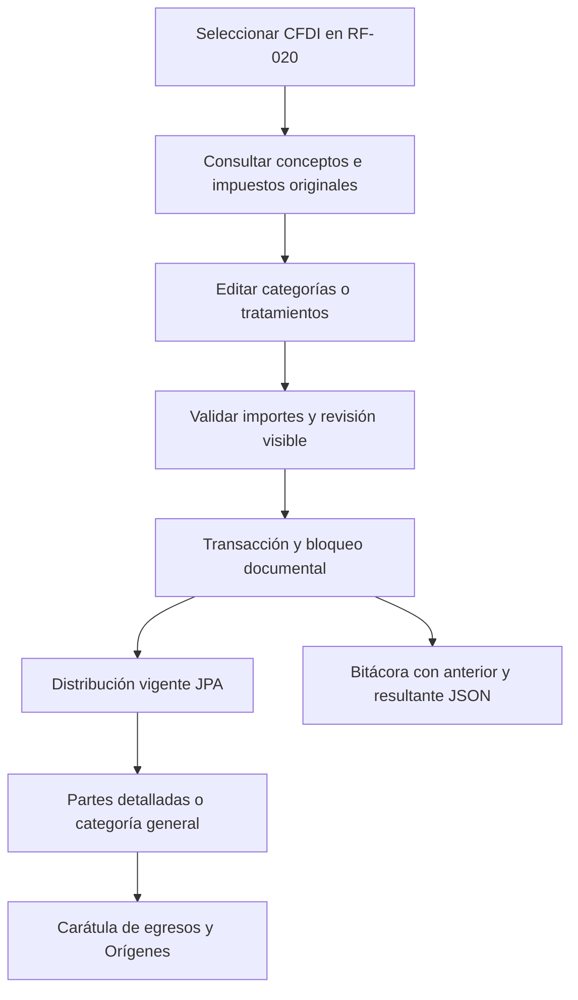

# RF-021 — Clasificación detallada de conceptos y tratamientos

## Objetivo y estado

Registrar una distribución administrativa de cada concepto de un CFDI y una
distribución independiente del importe original de cada impuesto. El XML,
sus conceptos y sus impuestos permanecen intactos. La clasificación pertenece
al contribuyente y al documento; no se vuelve a crear al cambiar de mes.

El código incorpora servicios, entidades y una interfaz integrada con RF-020.
La validación de la revisión más reciente se registra en
[MVP-ETAPA-1-ESTADO.md](MVP-ETAPA-1-ESTADO.md).

## Alcance implementado

- Consulta paginada de conceptos: producto, descripción, importe, descuento,
  neto, ObjetoImp y categoría general de referencia.
- Consulta de impuestos originales del concepto: código, movimiento, factor,
  base, tasa/cuota e importe, conservando los valores ausentes.
- Distribuciones entre categorías por importe o proporciones entre cero y uno.
- Tratamientos parciales independientes para cada impuesto con importe declarado.
- Observaciones y justificaciones de hasta 600 caracteres por asignación.
- Revisión conjunta del documento, guardado atómico e historial anterior/resultante.
- Carátula de egresos y orígenes fiscales que consumen las distribuciones detalladas.

La naturaleza administrativa no representa deducibilidad. El tratamiento
`IVA_ACREDITABLE` registra una decisión del operador, no una comprobación
automática de los requisitos de la LIVA. Las reglas de realización financiera
pertenecen a [RF-023](RF-023.md) y al [motor fiscal](MOTOR-FISCAL.md).

## Modelo de datos reutilizado

| Estructura existente | Función en RF-021 |
| --- | --- |
| `cfdi_concepto` | Fuente inmutable del importe y descuento; identidad del concepto. |
| `cfdi_concepto_impuesto` | Fuente inmutable de cada base e impuesto original. |
| `categoria_operacion` | Categorías y naturalezas propias del contribuyente. |
| `clasificacion_operacion_evento` | Última categoría general RF-020, usada como referencia predeterminada. |
| `clasificacion_concepto` | Distribución vigente del neto del concepto entre categorías. |
| `tratamiento_impuesto` | Catálogo independiente de tratamientos. |
| `clasificacion_impuesto_concepto` | Distribución vigente del importe declarado entre tratamientos. |
| `bitacora_evento` | Identidad de revisión, actor, contribuyente, documento, acción, motivo y `ocurrido_en`. |
| `bitacora_cambio` | Instantáneas JSON de distribuciones anterior y resultante. |

`ClasificacionConceptoEntity` y `ClasificacionImpuestoConceptoEntity` mapean
las tablas existentes mediante JPA. No se añade DDL ni una tabla paralela.
Las restricciones y triggers vigentes siguen comprobando pertenencia al
contribuyente. Los límites agregados se comprueban en el servicio.

Las filas vigentes se sustituyen al guardar una revisión. El historial durable
se conserva en la bitácora; no se intenta usar las filas vigentes como un
historial append-only. La aplicación no elimina los eventos anteriores.

## Precedencia y conciliación administrativa

El importe distribuible de un concepto es:

```text
neto_concepto = importe_original - descuento_original
pendiente = neto_concepto - suma_asignaciones
```

Las siguientes reglas se aplican en `FiscalSql.partes`, que alimenta egresos
y orígenes del resumen fiscal:

1. Sin filas detalladas, se hereda la categoría general RF-020 del documento.
   Si tampoco existe categoría general, el neto queda sin clasificación.
2. Con al menos una fila detallada, esas filas sustituyen la categoría general
   para todo el concepto. El remanente queda `SIN_CLASIFICAR`; no vuelve a
   heredar la categoría general.
3. Una lista vacía guardada retira el detalle y restaura la regla predeterminada.
4. Una asignación explícita de cero conserva la existencia de detalle y deja
   el neto correspondiente como remanente pendiente.
5. Si se encuentran distribuciones heredadas que exceden el neto, la proyección
   las identifica como `REVISAR_EXCESO` y evita sumar sus importes como válidos.

La base de un impuesto no se equipara al neto del concepto. En las carátulas,
una base o impuesto distribuido por categoría se identifica como derivado:

```text
base_distribuida = base_original × neto_asignado / neto_original_concepto
impuesto_distribuido = impuesto_original × neto_asignado / neto_original_concepto
```

La consulta conserva los originales al lado de los derivados. Los netos cero,
las bases distintas del neto y los desgloses ambiguos no se corrigen alterando
el XML. Requieren inspección de las columnas e incidencias disponibles.
Cada parte derivada se trunca a seis decimales hacia cero; la última categoría
recibe el residuo del original. La prueba con impuesto `0.000002` repartido
entre cuatro categorías comprueba importes no negativos y suma exacta.

`ResumenClasificacionService` aplica la misma precedencia al resumen RF-020.
Cuenta cada CFDI una vez en el total documental y permite su presencia en
varias naturalezas sin duplicar la suma monetaria. La carátula de egresos y
Orígenes usan el mismo conjunto de partes distribuidas.

## Precisión, proporciones y residuos

`DistribucionDecimal.validar` rechaza asignaciones negativas, valores que no
caben en `DECIMAL(20,6)` y sumas superiores al original. Permite asignaciones
parciales y cero. Rechaza un distribuible negativo. El guardado admite hasta
100 destinos distintos por origen; una categoría no puede repetirse en la
misma distribución.

Para proporciones, `DistribucionDecimal.proporciones`:

1. Comprueba cada proporción en `[0,1]` y su suma no superior a uno.
2. Multiplica el original por cada proporción usando `BigDecimal`.
3. Trunca cada resultado a seis decimales mediante `RoundingMode.DOWN`.
4. Si la suma de proporciones es uno, entrega el residuo al último renglón.
   Si es parcial, conserva el importe no distribuido como pendiente.

Por ejemplo, distribuir `1.000000` con proporciones `0.333333333333`,
`0.333333333333` y `0.333333333334` produce `0.333333`, `0.333333` y
`0.333334`. Es una regla administrativa de persistencia, no una regla fiscal
de redondeo de declaraciones. No se recalcula el impuesto original con ella.

## Transacción, revisión e historial

`ClasificacionDetalleService.guardar` utiliza `JpaContext.enTransaccion`:

1. Exige usuario activo, `OPERACIONES.CONSULTAR`, asignación explícita y
   documento no archivado. Exige `OPERACIONES.CLASIFICAR_DETALLE` para escribir.
2. Bloquea el vínculo `contribuyente_documento` mediante `FOR UPDATE`.
3. Lee la revisión más reciente con `ORDER BY id DESC LIMIT 1 FOR UPDATE`.
   Esta lectura actual evita aceptar una revisión obsoleta después de esperar
   un bloqueo bajo el aislamiento de MySQL.
4. Comprueba que el concepto o impuesto pertenezca al documento autorizado,
   valida límites y ordena las entradas por destino para comparar cambios.
5. Rechaza categorías ajenas o inactivas y tratamientos inexistentes.
6. Sustituye filas vigentes mediante JPA y registra evento y cambio JSON en
   la misma transacción y conexión. Un error revierte distribución y auditoría.

La revisión es conjunta para conceptos y tratamientos del documento. Editar
otro concepto del mismo documento puede invalidar una selección anterior;
el usuario debe actualizar antes de volver a guardar.

La primera distribución de cada origen sin historial admite el motivo
automático «Clasificación inicial manual mediante RF-021.». Los cambios
posteriores, retiros y reasignaciones requieren motivo explícito. Una operación
sin cambios no crea historial. Las notas forman parte de la comparación.

## Servicios e interfaz

- `ClasificacionDetalleService`: `conceptos`, `impuestos`, `tratamientos`,
  `consultar`, `guardar` e `historial`.
- `DistribucionDecimal`: validación monetaria y conversión de proporciones.
- `AccesoFiscal`: permiso vigente, asignación explícita y disponibilidad.
- `FiscalSql` y `ResumenFiscalService`: precedencia y proyecciones por naturaleza.
- `Fr_DatosClasificacionDetalle`: detalle de un único comprobante desde
  `PanelClasificacionOperaciones`; no crea otra ventana principal.

El diálogo usa constructor público vacío, componentes explícitos, `GroupLayout`,
tablas, `JComboBox` reutilizable, `JSplitPane` y pestañas. Los servicios se inyectan
después de construirlo. Las consultas y escrituras usan `SwingWorker`; un token
de generación evita aplicar respuestas anteriores. Esc cancela la edición.
Tras guardar se recarga el detalle; al regresar se actualiza RF-020.

Se consultan 100 conceptos por página. El servicio pagina el historial; el
diálogo muestra las últimas 100 revisiones. No declara haber abierto el archivo
en Eclipse WindowBuilder ni comprobado manualmente sus tamaños.

## Ejemplo de operación mixta

| Concepto | Neto original MXN | Categoría | Naturaleza |
| --- | ---: | --- | --- |
| Materia prima | 10,000.00 | COSTO | COSTO |
| Papelería | 2,000.00 | GASTO | GASTO |
| Equipo de cómputo | 15,000.00 | INVERSION | INVERSION |

La suma detallada es `27,000.00`, aunque el documento tenga una categoría
general GASTO. La carátula detallada no vuelve a sumar `27,000.00` como gasto.
Si de materia prima se asignan sólo `6,000.00`, los `4,000.00` restantes quedan
pendientes; no se convierten automáticamente en gasto.



## Pruebas y criterios de aceptación

`DistribucionDecimalTest` cubre parciales, límites, negativos, precisión,
proporciones y residuos. `ClasificacionDetalleServiceIT` cubre el ejemplo
mixto, tratamientos parciales, originales intactos, no-op, historial, retiro,
revisión obsoleta, ediciones concurrentes, rollback, categorías ajenas o
inactivas, permisos, revocación, archivado y documentos compartidos.
`MvpFiscalServiceIT` comprueba su consumo en carátulas y orígenes.

Se considera aceptado cuando las distribuciones concilian sin duplicaciones,
se preservan originales e historial, y las pruebas MySQL y del flujo contable
terminan satisfactoriamente. La presencia del código de prueba no acredita
que esas condiciones ya se hayan verificado.

```bash
mvn --batch-mode --no-transfer-progress -f app/pom.xml verify
```

## Fuentes, dependencias y límites

La estructura documental procede del Anexo 20 y catálogos SAT, no de categorías
heredadas de Excel. Para fuentes oficiales, versiones, LIVA y límites de los
tratamientos consulte [MOTOR-FISCAL.md](MOTOR-FISCAL.md). La precedencia y el
reparto decimal son decisiones administrativas de diseño; no se presentan
como fórmulas tributarias ordenadas por una disposición legal.

Depende de RF-003, RF-004, RF-007, RF-013 y RF-020, del esquema canónico
actual y de los permisos incrementales de RF-003. No modifica las reglas de
conexión, autenticación, XML original ni `hibernate.hbm2ddl.auto=validate`.

Pendientes: integración del resumen heredado RF-020, resultado de CI y pruebas
MySQL, diseñador WindowBuilder y validación visual a 740×490/900×700.
