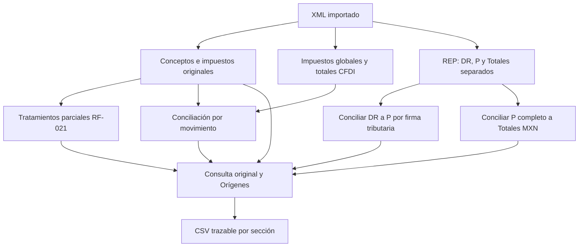

# RF-022 — Administración detallada de impuestos

## Objetivo y estado

Consultar los impuestos originales de CFDI y complementos de pagos, sus
tratamientos administrativos y las diferencias documentales implementadas,
con identificadores que permitan reconstruir cada importe.

El módulo comparte la tarjeta `PanelResumenFiscal` y el detalle por concepto
de RF-021. Se encuentra en validación. CI está en progreso; no se declaran
aprobadas las pruebas de integración ni la apertura en WindowBuilder.
Consulte [MVP-ETAPA-1-ESTADO.md](MVP-ETAPA-1-ESTADO.md) para el estado ejecutado.

## Alcance y separación de dimensiones

La consulta conserva código, traslado o retención, factor, tasa/cuota, base,
importe, moneda, documento, concepto o nodo de pago, según el nivel disponible.
No está limitada a IVA al 16%. Presenta tasas cero, otras tasas, exenciones,
ISR retenido e IEPS con tasa o cuota tal como se importaron.

Los códigos `001`, `002` y `003` se etiquetan ISR, IVA e IEPS. Un código
distinto permanece visible como `REVISAR_CATALOGO`; no se descarta ni se le
inventa significado. La etiqueta no verifica que una tasa o cuota corresponda
legalmente a la actividad y al periodo consultados.

La naturaleza y categoría generales se muestran separadas del impuesto.
Las distribuciones detalladas se reconstruyen desde Orígenes; las columnas
«Naturaleza general» y «Categoría general» no representan todas las partes
de una operación mixta. El tratamiento no equivale a la naturaleza contable.

Un concepto sin traslado IVA no se convierte en exento. ObjetoImp y los
conceptos sin desglose se consultan en el detalle y en las carátulas; el
listado de impuestos por sí solo no contiene una fila tributaria sintética
para un concepto que no tiene impuestos persistidos.

## Modelo existente y ausencia de DDL

| Nivel | Estructuras reutilizadas | Unidad del importe |
| --- | --- | --- |
| Concepto | `cfdi_concepto`, `cfdi_concepto_impuesto` | Moneda del CFDI. |
| Global | `cfdi_impuesto_global` | Moneda del CFDI; resumen original independiente. |
| Totales CFDI | `cfdi_impuesto_totales` | Totales trasladados y retenidos del encabezado. |
| Documento relacionado | `pago_fiscal_documento`, `pago_fiscal_impuesto_documento` | MonedaDR. |
| Nodo Pago | `pago_fiscal`, `pago_fiscal_impuesto_pago` | MonedaP. |
| Totales REP 2.0 | `pago_fiscal_totales` | Monto total de pagos en MXN. |
| Tratamientos | `tratamiento_impuesto`, `clasificacion_impuesto_concepto` | Parte del importe original del impuesto del concepto. |

No se crea un segundo almacén tributario ni se modifica el esquema o los
procedimientos de importación. `pago_fiscal_total_impuesto` conserva atributos
tributarios originales del complemento. `Nivel.TOTALES` presenta los totales
de cabecera; `ConciliacionPagosService.totales` compara además los atributos
tributarios MXN del complemento con los derivados de sus nodos Pago.

Los importes ausentes se mantienen como `null`, incluido un impuesto exento
sin importe. Ninguna consulta convierte automáticamente esa ausencia en un
importe fiscal confirmado de cero.

## Servicios y niveles de consulta

`ImpuestosService.consultar` expone cinco niveles independientes:

| `Nivel` | Contenido y temporalidad |
| --- | --- |
| `CONCEPTO` | Documento, concepto e impuesto original; filtra emisión del CFDI. |
| `GLOBAL` | Impuesto global original por documento; filtra emisión. |
| `PAGO_DOCUMENTO` | REP, nodo Pago, documento relacionado, MonedaDR, equivalencia e impuesto DR; filtra FechaPago. |
| `PAGO` | REP, nodo Pago, MonedaP, tipo de cambio e impuesto P; filtra FechaPago. |
| `TOTALES` | Totales del CFDI y monto total de pagos MXN cuando existen; filtra emisión del documento. |

`ResumenFiscalService` despacha estos niveles, las conciliaciones documentales
y de pagos y las carátulas de IEPS y retenciones. Las secciones
`IMPUESTOS_DR`, `CONCILIACION_DR_P` y `CONCILIACION_TOTALES` permiten consultar
específicamente esos resultados; su integración y SQL siguen en validación.
`TablaFiscal` conserva nombres de columnas,
valores nulos, aviso y continuidad de página. `FiscalSql` centraliza el
universo del titular y los filtros parametrizados.

Se recuperan 200 filas y una adicional para identificar continuidad. La
tabla ordena mediante identificadores estables en la consulta; el orden
visual de una página no cambia la agregación de MySQL. No se recorren XML
ni se hacen consultas desde renderizadores.

## Filtros y agrupaciones disponibles

`FiltroFiscal` valida contribuyente, fechas inclusivas, sentido, prefijo RFC,
naturaleza, categoría, moneda documental, tipo CFDI y estado SAT. Los límites
temporales SQL son `[inicio, día posterior al final)`; no se pierden las horas
del último día. Naturalezas, tipos y estados usan dominios cerrados.

La pestaña **Tributos por categoría** agrupa impuestos de conceptos por
tercero, sentido, tipo, moneda, estado, naturaleza, categoría, código,
movimiento, factor, tasa/cuota y tratamiento. Una asignación parcial genera
filas distintas para cada tratamiento y el remanente pendiente; las partes
monetarias se suman sin repetir el impuesto completo por categoría. Los
originales globales, DR, P y Totales mantienen sus niveles independientes;
no se combinan en una única suma tributaria. Terceros conserva su propia
agrupación documental.

En los niveles originales `PAGO` y `PAGO_DOCUMENTO`, el filtro de moneda se
aplica respectivamente a MonedaP y MonedaDR, sin confundirlas con la moneda
de cabecera del CFDI REP, habitualmente `XXX`. Totales y conciliaciones
identifican expresamente la unidad monetaria de sus cifras; seleccionar
moneda no convierte por sí mismo un original.

## Conciliación implementada

`ImpuestosService.conciliar` calcula, por documento y movimiento:

```text
conceptos = suma de importes originales de impuestos de conceptos
globales = suma de importes originales de impuestos globales
total_xml = total trasladado o retenido declarado en el CFDI
diferencia_concepto_global = conceptos - globales
diferencia_global_total = globales - total_xml
```

La reducción de conceptos y globales ocurre en CTE independientes antes de
unir resultados. Esto evita multiplicar importes por un join entre varios
conceptos y varios impuestos globales. Si un nivel está ausente, la diferencia
queda ausente; no se rellena con cero para aparentar conciliación.

La conciliación actual es agregada por traslado o retención. No reemplaza
una comparación por código, factor y tasa, ni una validación de bases,
deducibilidad o acreditamiento. Una diferencia visible no se corrige en el XML.

### Conciliación DR contra P

`ConciliacionPagosService.documentosContraPago` compara por nodo Pago y firma
tributaria: código, movimiento, factor y tasa/cuota. Para expresar cada DR
en MonedaP divide su base e importe entre `EquivalenciaDR`, salvo que ambas
monedas sean iguales. Agrega esos derivados y los compara con `ImpuestosP`.

```text
DR_en_MonedaP = DR_original / unidades_MonedaDR_por_MonedaP
diferencia_base = suma_bases_DR_convertidas - base_P_original
diferencia_impuesto = suma_impuestos_DR_convertidos - impuesto_P_original
```

La unión de firmas de ambos niveles conserva las presentes sólo en DR o P.
Las ausencias y los factores no verificables producen valores nulos y un
contador de líneas sin factor, no una conciliación artificial. La conversión
se identifica como derivada; no modifica los originales.

### Conciliación P contra Totales MXN

`ConciliacionPagosService.totales` selecciona los REP con algún pago en el
periodo y compara **todos los nodos Pago del REP completo** con Totales.
Un complemento que incluya fechas de distintos meses no se concilia contra
una fracción mensual de un total que corresponde a todo el complemento.

Convierte los importes de cada nodo con su `TipoCambioP`, salvo MonedaP MXN,
y conserva indicadores de tipos de cambio ausentes. Compara `MontoTotalPagos`
y atributos tributarios de `pago_fiscal_total_impuesto`: retenciones ISR,
IVA e IEPS; bases e impuestos IVA de tasas representadas en Totales; base
exenta. Une atributos originales y derivados, conservando ausencias de
cualquiera de los niveles. La diferencia se expresa en MXN.

Las firmas con tasas o impuestos que no tengan representación en los
atributos de Totales siguen visibles en DR/P; no se inventa un atributo.
Estas consultas nuevas están en validación MySQL y de interfaz. La existencia
del cálculo no acredita que sus pruebas ya hayan pasado.

Los niveles se comparan, nunca se suman como hechos tributarios distintos.
[RF-023](RF-023.md) usa DR como fuente de evidencia individual y mantiene
la conciliación del REP separada del reconocimiento mensual.

## Tratamientos parciales y precisión

El alta o cambio del tratamiento se hace mediante
`ClasificacionDetalleService.guardar`, `Tipo.IMPUESTO`, dentro del contrato
de [RF-021](RF-021.md). Se conserva el importe original, se rechazan importes
negativos y asignaciones superiores a él, y se admite remanente pendiente.
Un impuesto sin importe declarado no puede recibir un importe inventado.

Ejemplo administrativo: IVA original `160.00`; asignar `80.00` a
`IVA_ACREDITABLE` y `40.00` a `IVA_NO_ACREDITABLE` deja `40.00` pendientes.
El listado original sigue mostrando `160.00`. No se suman `160+80+40` ni
se reconoce pago por guardar esos tratamientos.

Las asignaciones usan `BigDecimal` y `DECIMAL(20,6)`. La conversión desde
proporciones y sus residuos a seis decimales están descritos en RF-021.
Las consultas originales no recalculan importes multiplicando bases por
`0.16`; un IEPS de cuota conserva su base y cuota propias. Las conversiones
monetarias derivadas del auxiliar IVA están identificadas en MOTOR-FISCAL.

## Seguridad, transacciones e interfaz

Cada lectura exige `FISCAL.CONSULTAR`, usuario activo y asignación explícita
en `usuario_contribuyente`, también para ADMIN. La disponibilidad excluye
vínculos archivados. Se conserva el último estado SAT almacenado, incluido
`SIN_CONSULTA`; la consulta no verifica SAT en red ni presume vigencia.

Consultar o escribir tratamientos requiere además los permisos de operaciones
que el servicio RF-021 comprueba. La escritura revalida autorización dentro de
la transacción. Los nuevos permisos siguen el bootstrap incremental RF-003;
un reinicio no restaura permisos previamente revocados.

`JpaContext.enTransaccion` delimita lecturas consistentes y escrituras.
Las agregaciones nativas se justifican por sus CTE y reducción de niveles;
usan el mismo contexto, sin conexiones independientes ni transacciones SQL
internas. Hibernate permanece en `validate`.

`PanelResumenFiscal` se abre dentro del `CardLayout` principal y contiene
pestañas de impuestos, totales, conciliación, IEPS y retenciones. El detalle
existente de CFDI y Orígenes permiten seguir identificadores de documento,
concepto, impuesto o REP. `Fr_DatosClasificacionDetalle` permite modificar
tratamientos sin editar atributos originales.

Los constructores visuales no abren persistencia. `SwingWorker` realiza las
consultas, los filtros se aplican con Buscar y tokens de generación evitan
que una respuesta anterior sustituya la selección vigente. Se conserva
`GroupLayout`; WindowBuilder y tamaños de escritorio requieren comprobación
manual real.

CSV exporta todas las páginas con las columnas de la sección seleccionada,
sin mezclar niveles ni monedas. La exportación revalida permisos por página,
conserva decimales y deja vacíos los nulos; no constituye un cierre histórico
inmutable si otros operadores modifican datos durante la exportación.



## Pruebas, aceptación y pendientes

`MvpFiscalServiceIT` prepara datos sintéticos con IVA 16%, tasa cero,
exención, retenciones ISR/IVA, IEPS cuota y REP en dos meses. Recorre todos
los valores de `ImpuestosService.Nivel` y `ResumenFiscalService.Seccion`,
verifica columnas, originales y carátulas, y genera un EXPLAIN sobre la
proyección fiscal. `ClasificacionDetalleServiceIT` cubre tratamientos e
historial. `ExportacionFiscalServiceTest` y `PanelResumenFiscalTest` comprueban
CSV y construcción/interacción Swing sin base de datos.

```bash
mvn --batch-mode --no-transfer-progress -f app/pom.xml verify
```

La aceptación exige trazabilidad, originales intactos, ausencia de duplicación,
aislamiento, permisos efectivos y pruebas MySQL satisfactorias. Permanecen
pendientes la validación de la revisión más reciente en CI y la comprobación
real de WindowBuilder. La pestaña **Tributos por categoría** agrupa por
tercero, sentido, tipo, moneda, estado SAT, naturaleza, categoría, impuesto,
movimiento, factor, tasa/cuota y tratamiento. Bases e importes son
distribuciones derivadas; el original permanece accesible por concepto.
No se declara cumplimiento total mientras esos límites permanezcan abiertos.

## Fuentes y dependencias

La estructura procede de Anexo 20, estándar CFDI, complementos Pagos 1.0/2.0
y catálogos `c_Impuesto`, `c_TipoFactor`, `c_TasaOCuota` y `c_ObjetoImp` del
SAT. [MOTOR-FISCAL.md](MOTOR-FISCAL.md) registra los enlaces oficiales,
versiones, vigencias verificadas e incertidumbres históricas. Los tratamientos
especiales requieren fundamento y evidencia propios; el catálogo editable no
crea una exención o acreditamiento autorizado por ley.

Depende de RF-003/004 para seguridad, RF-007 para originales persistidos,
RF-015/017 para detalle, RF-020/021 para clasificación y RF-023/024 para
realización y saldos. No instala catálogos oficiales nuevos, no modifica XML
y no determina definitivamente IVA, ISR o IEPS.
