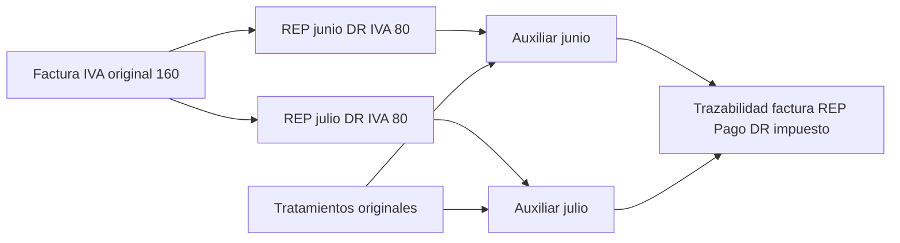

# RF-023 — Determinación y control auxiliar de IVA

## Estado, objetivo y alcance

Servicios implementados en validación. No se declara completada la Definition
of Done ni aprobada la integración MySQL, la prueba contable integral o el
diseñador Eclipse WindowBuilder. El avance verificable se conserva en
`MVP-ETAPA-1-ESTADO.md`.

El objetivo es distinguir IVA documental, realización financiera, tratamientos
parciales y pendientes con trazabilidad. Esta versión consulta evidencia REP
por FechaPago y conserva originales separados de conversiones y tratamientos
derivados. Incluye una carátula agregada REP y evidencia manual con estimación
proporcional expresamente pendiente. No emite una determinación tributaria
definitiva.

## Modelo de datos

Se reutilizan las estructuras existentes:

| Dimensión | Tablas |
| --- | --- |
| Documento y alcance | `documento_fiscal`, `cfdi`, `contribuyente_documento`, `usuario_contribuyente` |
| Impuesto original | `cfdi_concepto`, `cfdi_concepto_impuesto`, `cfdi_impuesto_global`, `cfdi_impuesto_totales` |
| Tratamiento | `clasificacion_impuesto_concepto`, `tratamiento_impuesto` |
| Evidencia REP | `pago_fiscal`, `pago_fiscal_documento`, `pago_fiscal_complemento`, `pago_fiscal_impuesto_documento`, `pago_fiscal_impuesto_pago`, `pago_fiscal_totales`, `pago_fiscal_total_impuesto` |
| Evidencia administrativa | `obligacion`, `movimiento_pago`, `aplicacion_pago`, `movimiento_pago_complemento`, `ajuste_obligacion` |
| Estado y auditoría | `consulta_estado_sat`, `bitacora_evento` |

RF-023 no crea un segundo modelo de cuentas por cobrar o pagar. Las
clasificaciones no modifican XML, bases originales ni método de pago.

## Reglas de negocio y algoritmo

`AuxiliarIvaService.consultar` obtiene 200 filas y una adicional para
continuidad. Los acumulados históricos se calculan en MySQL antes de paginar.
El rango se aplica a FechaPago, sin restringir la emisión de la factura al
mismo mes. Cada fila conserva REP, Pago, DR, factura e impuesto de origen.

Se comprueban estados SAT, disponibilidad del titular, correspondencia de
monedas y sentidos, tipo I de factura, saldos, parcialidades repetidas y límites
acumulados de pago/impuesto. Se conserva la ausencia de confirmación como
`null`. Cancelados, estados desconocidos, información insuficiente y
sustituciones detectadas generan revisión.

`MotorIva` recibe el importe IVA DR declarado y la firma tributaria original.
No agrega nuevamente impuestosP, Totales o IVA global de factura. Proyecta el
tratamiento del impuesto original sobre el importe realizado, conserva
remanentes y distingue conversión MXN. Acreditable y no acreditable sólo se
proyectan sobre recibido/traslado; retenciones requieren análisis separado.

`AuxiliarIvaService.resumir` separa IVA documental por fecha de emisión de IVA
realizado por FechaPago. La segunda fuente comparte los controles del detalle
REP. Agrupa el universo por sentido, moneda, movimiento y estados SAT.
Muestra potencial, acreditable registrado, no acreditable y pendiente en
columnas distintas. No suma páginas Swing ni mezcla monedas. Si no existe
importe confirmable conserva `null`, no un cero fiscal confirmado.

`consultarManuales` consulta aplicaciones de movimientos manuales del mismo
titular por fecha de movimiento. Expone documento, UUID, movimiento, monedas,
importe de pago, aplicación, IVA original y estimación proporcional derivada.
Cada fila mantiene `PENDIENTE_REVISION_FISCAL`; la estimación nunca es
acreditable confirmado. Excluye movimientos ya vinculados a DR para ese mismo
titular. Si hay REP activo todavía sin vincular del titular, suspende la
estimación y advierte sobre posible duplicación. La exclusión no impide que
otro titular autorizado administre su propia evidencia del documento compartido.

## Reglas fiscales y fundamentos

La matriz jurídica, fechas comprobadas, algoritmos y enlaces completos están
en [MOTOR-FISCAL.md](MOTOR-FISCAL.md).

- [LIVA](https://www.diputados.gob.mx/LeyesBiblio/pdf/LIVA.pdf), artículos
  1-B, 5 I–V, 5-D y 7: realización, requisitos, retención, temporalidad y ajustes.
- [Reglamento LIVA](https://www.diputados.gob.mx/LeyesBiblio/regley/Reg_LIVA_250914.pdf),
  artículo 24: restitución y aplicación efectiva de descuentos.
- [CFF](https://www.diputados.gob.mx/LeyesBiblio/pdf/CFF.pdf), artículos 29 y
  29-A: documentación y pagos vinculados.
- [RMF 2026](https://sat.gob.mx/minisitio/NormatividadRMFyRGCE/documentos2026/rmf/compiladas/Compilado_Tercera_Modificacion_a_la-Resolucion_Miscelanea_Fiscal_para_2026.pdf),
  reglas 2.7.1.32 y 2.7.1.39: REP y opción documental PUE.
- [SAT Pagos 2.0](https://www.sat.gob.mx/sitio_internet/cfd/Pagos/Pagos20.xsd):
  unidades monetarias, FechaPago y precisión de EquivalenciaDR.

PUE no confirma por sí solo el cobro. `IVA_ACREDITABLE` registrado no certifica
requisitos legales. Ante IVA retenido el motor mantiene pendiente el potencial
acreditable, sin evidencia de entero y periodo posterior. Una NC no demuestra
automáticamente restitución efectiva. IEPS e ISR no heredan reglas de IVA.

## Precisión y temporalidad

Se usan `BigDecimal` y `DECIMAL`, conservando moneda original. EquivalenciaDR
admite diez decimales en el XSD actual. La conversión derivada divide DR por
unidadesDR/unidadP y multiplica por MXN/unidadP; nunca inventa un tipo de cambio
entre distintas monedas. El redondeo interno y los residuos se documentan en
el motor; no se presentan como redondeo normativo de declaración.

La evidencia de cada pago se reconoce en su FechaPago. Se distingue emisión
del CFDI, fecha de ajuste y periodo seleccionado. El último estado SAT guardado
no equivale a una reconstrucción del estado fiscal histórico.

## Servicios, interfaces y permisos

- `AuxiliarIvaService`: lectura mensual REP, controles acumulados, resumen
  agregado SQL y consulta de evidencia manual con estimación pendiente.
- `MotorIva`: evaluación pura de evidencia, tratamiento y conversión.
- `EvidenciaFinancieraService`: registro administrativo y vinculación explícita
  sobre obligaciones, aplicaciones y ajustes existentes.
- `ResumenFiscalService`: despacho de `IVA`, `IVA_RESUMEN`, `IVA_MANUAL` e
  `IMPUESTOS_DR`, manteniendo separado cada nivel original o derivado.
- `PanelResumenFiscal`: pestañas **IVA por pago**, **Carátula IVA**,
  **Evidencia manual IVA** e **Impuestos DR originales**, con búsqueda explícita,
  paginación y exportación CSV de todas las páginas. Las tres últimas se
  añadieron al final del conjunto existente. La aceptación visual en
  WindowBuilder y resoluciones objetivo requiere prueba manual real.

`FISCAL.CONSULTAR` protege el auxiliar.
`FISCAL.REGISTRAR_EVIDENCIA` protege las escrituras financieras, que requieren
también consulta. `AccesoFiscal` revalida usuario activo, permiso efectivo,
asignación explícita al contribuyente y disponibilidad documental. ADMIN no
elude la asignación. Los permisos nuevos usan el bootstrap incremental RF-003,
sin restaurar concesiones revocadas.

## Transacciones y concurrencia

Las lecturas del auxiliar usan `JpaContext.enTransaccion`. Las escrituras
financieras comparten una transacción JPA y registran auditoría en ella. Se
bloquean vínculos documentales y obligaciones para validar límites antes de
persistir. Un fallo revierte movimientos, aplicaciones, ajustes y auditoría.
No se ejecutan confirmaciones independientes desde procedimientos ni se
abren conexiones laterales. Hibernate mantiene `hbm2ddl.auto=validate`.

## Ejemplo obligatorio

Datos sintéticos: factura PPD con subtotal 1,000.00 MXN, IVA original
160.00 MXN y total 1,160.00 MXN. Dos pagos de 580.00 MXN, uno en junio
y otro en julio, declaran IVA DR 80.00 MXN cada uno.

| Concepto | Junio | Julio | Total de ambos meses |
| --- | ---: | ---: | ---: |
| Pago documentado MXN | 580.00 | 580.00 | 1,160.00 |
| IVA DR realizado, si pasa controles | 80.00 | 80.00 | 160.00 |
| IVA original de la factura | 160.00 conservado | 160.00 conservado | No sumar otra vez |

La factura puede emitirse en un mes anterior. El IVA original no se duplica
por consultar dos periodos. El acreditable depende además de sentido,
tratamiento y restricciones; no se deduce únicamente del ejemplo aritmético.



## Pruebas y criterios de aceptación

Existe `MotorIvaTest` para 80 + 80, estados SAT, información insuficiente,
sustituciones, moneda, tratamientos parciales, IVA retenido y excesos. Es una
prueba del componente puro; no demuestra aún todo el flujo MySQL/Swing.

La aceptación completa requiere:

1. Probar fecha de reconocimiento entre meses y ejercicios con SQL real.
2. Verificar acumulados sobre más de una página y ausencia de duplicación.
3. Probar permisos, revocación, dos titulares y documentos compartidos.
4. Reproducir cancelaciones de factura/REP, sustituciones y monedas distintas.
5. Conciliar originales de concepto/globales y niveles DR/P/Totales.
6. Integrar evidencia manual y ajustes sin confirmaciones tributarias falsas.
7. Reconstruir cada cifra de carátula desde sus registros de origen.
8. Ejecutar la prueba contable de dos meses y el comando completo:

```bash
mvn --batch-mode --no-transfer-progress -f app/pom.xml verify
```

Los resultados ejecutados se registran en el documento de estado. No se
declara `BUILD SUCCESS` a partir de la mera existencia de estas pruebas.

## Limitaciones y dependencias

- La carátula de realización confirmable parte de REP. La pestaña de evidencia
  manual permite inspeccionar pagos sin REP y su IVA proporcional derivado,
  siempre pendiente de revisión. No se suma esa estimación al IVA REP ni se
  confirma automáticamente impuesto realizado o acreditable.
- La conciliación DR/P/Totales identifica diferencias por firma y atributo;
  no acredita el entero de retenciones ni libera automáticamente el
  acreditamiento retenido en el periodo posterior.
- Ajustes financieros no determinan automáticamente IVA de restituciones.
- Históricos sin desglose DR permanecen pendientes; no se inventa impuesto.
- La selección de la versión jurídica de cada ejercicio no está automatizada;
  reglas históricas o especiales no verificadas requieren revisión.
- No se determinan ISR integral, IEPS definitivo, factoraje, importaciones ni
  tratamientos de inversiones o regímenes especiales sin sustento específico.
- Depende de RF-003/004 para seguridad, RF-007 para originales y pagos,
  RF-013 para disponibilidad, RF-020/021 para clasificación, RF-022 para
  impuestos y conciliación, y RF-024 para evidencia y saldos documentados.
