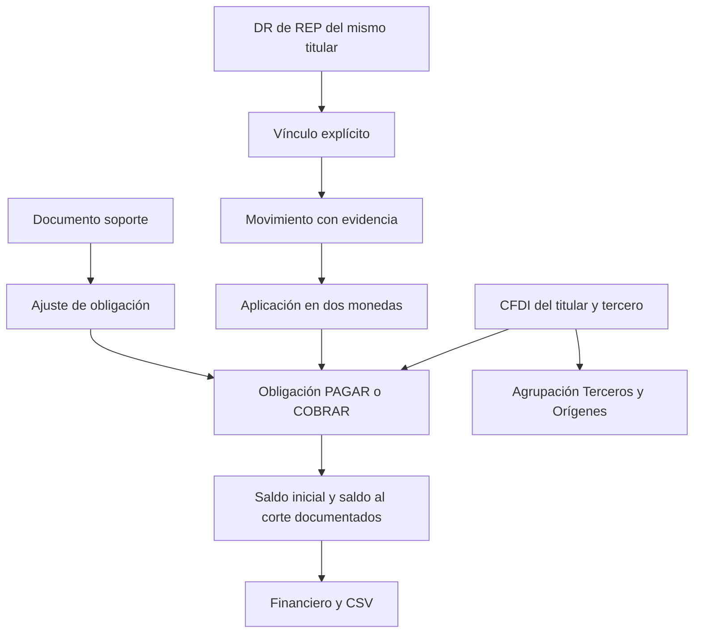

# RF-024 — Control de operaciones con terceros

## 1. Objetivo

Consolidar operaciones documentales y consultar pagos, cobros, ajustes y saldos
documentados por contribuyente y contraparte. El usuario debe poder distinguir
importe original, importe ajustado y saldo respaldado por registros sin
presumir que la información histórica está completa.

## 2. Alcance y estado

Servicios e interfaz implementados en validación. Este documento no declara
completada la Definition of Done, aprobadas las pruebas MySQL, validado el
flujo integral ni ejecutado el diseñador Eclipse WindowBuilder. Consultar
`MVP-ETAPA-1-ESTADO.md` para resultados efectivos.

El módulo ofrece agrupación documental en **Terceros**, saldos individuales al
corte en **Financiero** y alta administrativa de evidencia o ajuste por factura.
Reutiliza el catálogo existente de terceros y el modelo de obligaciones. No
crea contribuyentes propios a partir de emisores o receptores importados.

## 3. Modelo de datos

| Información | Estructuras reutilizadas |
| --- | --- |
| Identidad y relación comercial | `tercero`, `documento_participante`, `contribuyente_tercero_rol` |
| Original y disponibilidad | `documento_fiscal`, `cfdi`, `contribuyente_documento`, `consulta_estado_sat` |
| Clasificación | `categoria_operacion`, `clasificacion_operacion_evento`, `clasificacion_concepto` |
| Impuestos | `cfdi_concepto`, `cfdi_concepto_impuesto` |
| Obligación y aplicaciones | `obligacion`, `movimiento_pago`, `aplicacion_pago` |
| Soporte REP y ajustes | `movimiento_pago_complemento`, `pago_fiscal`, `pago_fiscal_documento`, `ajuste_obligacion` |
| Autorización y auditoría | `usuario_contribuyente`, privilegios RF-003 y `bitacora_evento` |

Las entidades JPA financieras se mapean a tablas existentes. RF-024 no
instala procedimientos adicionales ni un segundo sistema de cuentas.

## 4. Reglas de negocio

- Se agrupan RFC, nombre y tercero con separación por sentido, tipo documental,
  moneda y último estado SAT. Se incluyen subtotal, descuentos, total, IVA de
  conceptos, IVA retenido, ISR retenido e IEPS de conceptos.
- Los CFDI E se muestran separados de I. No se netean automáticamente como
  devolución efectiva. La relación comercial procede del catálogo existente.
- La búsqueda admite mes, ejercicio o rango. En terceros se filtra emisión;
  los saldos consideran documentos anteriores al corte y movimientos previos.
- RFC, naturaleza, sentido, moneda y estado tienen filtros explícitos. El DTO
  permite categoría y tipo; no todos los filtros del DTO tienen control visual.
- Un filtro de naturaleza/categoría identifica documentos coincidentes, incluidos
  aquellos con conceptos detallados; el total documental sigue siendo el de
  esos documentos completos. La distribución por naturaleza se inspecciona en
  Egresos y Orígenes, sin llamar al total del documento una asignación parcial.
- Los movimientos mantienen moneda del pago y moneda de obligación por separado.
  Una factura recibida genera obligación PAGAR y un pago; una emitida, COBRAR
  y un cobro. El servicio de alta ordinaria requiere CFDI I y sentido inequívoco.
- Una obligación existente incompatible con total, moneda o tercero del CFDI
  requiere revisión; no se modifica para hacer coincidir los valores.
- Cada aplicación respeta saldo disponible, referencia y soporte. Un DR puede
  vincularse una vez por titular; emisor y receptor autorizados pueden registrar
  sus propios movimientos sobre un documento compartido.
- Una aplicación manual anterior puede vincularse con un DR importado después.
  Se exige coincidencia de titular, factura, fecha, moneda e importes y se
  conserva el movimiento y la aplicación originales. No se admite esta acción
  para movimientos repartidos entre varias obligaciones.
- Los ajustes requieren soporte disponible, moneda, tercero y sentido
  compatibles. Los importes aplicados al soporte se controlan por titular.
- Los registros conservan historia: no se cambian XML ni atributos fiscales.

## 5. Reglas fiscales

La clasificación y las aplicaciones son administrativas. No garantizan
acumulación, deducibilidad, acreditamiento, entero de retenciones ni restitución
de IVA. PUE no constituye por sí solo prueba de cobro o pago.

Una NC o un ajuste de obligación no demuestra devolución de dinero. Los
efectos fiscales de restituciones y descuentos requieren evidencia y revisión;
no se generan automáticamente desde el saldo financiero.

## 6. Fuentes normativas

Consultar [MOTOR-FISCAL.md](MOTOR-FISCAL.md) para versiones, fechas verificadas,
alcance histórico y reglas. Las referencias principales son:

- [LIVA](https://www.diputados.gob.mx/LeyesBiblio/pdf/LIVA.pdf), artículos
  1-B, 5 y 7: realización, acreditamiento y restituciones.
- [Reglamento LIVA](https://www.diputados.gob.mx/LeyesBiblio/regley/Reg_LIVA_250914.pdf),
  artículo 24: restitución y aplicación de descuentos.
- [CFF](https://www.diputados.gob.mx/LeyesBiblio/pdf/CFF.pdf), artículos
  29 y 29-A: documentación fiscal y pagos posteriores.
- [SAT, complemento de pagos](https://wwwmat.sat.gob.mx/consultas/92764/comprobante-de-recepcion-de-pagos):
  evidencia estructurada de documentos relacionados.

La aritmética de saldo descrita aquí es una reconstrucción administrativa,
no un algoritmo de determinación tributaria integral.

## 7. Servicios

- `TercerosFiscalService.consultar`: agrupación SQL del universo documental
  filtrado, independiente de la página cargada.
- `TercerosFiscalService.saldos`: apertura documentada, aplicaciones previas,
  pagos y ajustes del periodo e importe al corte.
- `EvidenciaFinancieraService.referencias`: opciones REP del titular aún no
  vinculadas; hasta 200 referencias por consulta.
- `EvidenciaFinancieraService.registrar`: obligación, movimiento, aplicación,
  vínculo REP opcional y auditoría en una transacción.
- `EvidenciaFinancieraService.aplicacionesNoVinculadas` y `vincular`:
  conciliación posterior de movimiento manual con DR, sin pago duplicado.
- `EvidenciaFinancieraService.ajustar` y `ajustarPorUuid`: reducción documentada
  de saldo con soporte y autorización revalidada.
- `ResumenFiscalService`: integración de las secciones TERCEROS y FINANCIERO.
- `ExportacionFiscalService`: CSV UTF-8 completo mediante lecturas paginadas.

## 8. Interfaces

`PanelResumenFiscal` se integra al CardLayout principal. Usa tablas de sólo
lectura en pestañas **Terceros** y **Financiero**, filtros inferiores y acciones
Buscar, paginación, Orígenes, Ver CFDI, Evidencia / ajuste y CSV completo.
La clasificación mixta permanece en su formulario de RF-021.

`Fr_DatosEvidencia` es un diálogo de una factura con pestañas de pago/cobro y
ajuste. Permite registrar referencias, fechas, importes por moneda y motivo;
la vinculación REP identifica el DR original. `SwingWorker` realiza lecturas y
escrituras fuera del EDT. Al cerrar el diálogo se recarga la consulta.

Los constructores vacíos y `GroupLayout` forman parte del diseño. La prueba
real de WindowBuilder y usabilidad a 740×490 y 900×700 permanece pendiente.

## 9. Permisos

Consulta y exportación requieren `FISCAL.CONSULTAR`. Las escrituras requieren
además `FISCAL.REGISTRAR_EVIDENCIA`. Cada servicio comprueba usuario activo,
privilegio efectivo y asignación explícita al contribuyente; ADMIN no tiene
excepción al alcance. Abrir el detalle original exige también los permisos
CFDI existentes.

El bootstrap incremental de RF-003 concede únicamente privilegios nuevos a
ADMIN y no restaura privilegios revocados. Los botones son una ayuda visual;
el servicio es responsable de exigir autorización.

## 10. Transacciones y concurrencia

Las operaciones usan `JpaContext`. La escritura bloquea el vínculo documental
y la obligación para comprobar límites; los ajustes bloquean origen y soporte
en orden estable. El servicio comprueba referencias y DR previamente aplicados,
así como el importe acumulado de ajustes sobre soporte del mismo titular.

La inserción de movimiento, aplicación, vínculo y auditoría se confirma o
revierte como una unidad. Hibernate valida el esquema; no lo actualiza.
No se ejecutan migraciones sobre bases reales desde estos servicios.

## 11. Algoritmos de saldo y rendimiento

Los importes de saldo se expresan en **moneda de la obligación**, mostrada
separadamente de la moneda CFDI. Las consultas usan CTE y agregación en MySQL
antes de paginar 200 filas; no cargan todas las facturas para sumar en Java.

```text
saldo inicial documentado = original − pagos anteriores − ajustes anteriores
importe ajustado al corte = original − ajustes hasta el corte
saldo documentado al corte = original − pagos hasta el corte − ajustes hasta el corte
```

La apertura sólo se calcula para obligaciones anteriores al inicio. Si la
obligación nace dentro del periodo, esa columna queda `null`. Sin obligación,
los valores financieros quedan ausentes y el estado es
`SALDO_PENDIENTE_CORROBORAR`. Tener una obligación produce
`SALDO_DOCUMENTADO_HISTORIA_PARCIAL`, no una garantía de historia completa.

Las aplicaciones con REP vinculado no disponible, archivado o cuyo último
estado SAT no sea VIGENTE se excluyen del pago que reduce el saldo mostrado;
su importe aparece separado como pago REP excluido. Los registros originales
se conservan. Los movimientos manuales siguen siendo evidencia administrativa.
Un REP sin aplicación no liquida automáticamente una obligación.

## 12. Ejemplo sintético

Factura original de 1,160.00 MXN emitida antes de junio. Pago de junio de
580.00 MXN y pago de julio de 580.00 MXN. Si ambas aplicaciones y soportes
son admisibles:

| Periodo | Saldo inicial documentado | Pago del periodo | Saldo al corte |
| --- | ---: | ---: | ---: |
| Junio | 1,160.00 | 580.00 | 580.00 |
| Julio | 580.00 | 580.00 | 0.00 |

Si no se registró obligación, el saldo es pendiente de corroborar, no cero.
Si posteriormente un REP vinculado queda cancelado, la aplicación queda
conservada pero el reporte separa su evidencia excluida. Este cambio no altera
la fecha histórica de pago ni confirma un nuevo hecho fiscal.

Una NC de 116.00 MXN puede reducir una obligación mediante ajuste documentado.
Su IVA o una devolución de efectivo no se reconocen automáticamente.

## 13. Diagrama



## 14. Pruebas

`MvpFiscalServiceIT` contiene un escenario sintético de dos meses con consultas,
aplicaciones, NC, permisos y dos titulares que comparten factura/REP. La
existencia del test no constituye ejecución satisfactoria. Las verificaciones
efectivas, errores y pendientes se registran en el documento de estado.

```bash
mvn --batch-mode --no-transfer-progress -f app/pom.xml verify
```

## 15. Criterios de aceptación

1. Consultar proveedor/cliente por RFC y periodo sin mezclar monedas ni sentidos.
2. Reconstruir importes documentales desde CFDI, conceptos e impuestos.
3. Obtener apertura y cierre desde obligaciones, pagos previos y ajustes.
4. Mantener ausencia de historia como pendiente y distinguir pagos excluidos.
5. Rechazar exceso, referencia repetida, soporte ajeno y duplicación de DR por
   titular sin bloquear la evidencia independiente de otro titular autorizado.
6. Verificar rollback, concurrencia, revocación y aislamiento con MySQL 8 real.
7. Exportar todo el resultado, revalidando permisos por página.
8. Comprobar interfaz, resoluciones y diseñador WindowBuilder efectivamente.

## 16. Limitaciones

- No se certifica que el saldo documentado represente toda la historia comercial.
- No se restauran estados SAT históricos: se utiliza la última consulta guardada.
- La columna IEPS de Terceros suma el impuesto de conceptos; el desglose por
  traslado/retención se consulta en las pestañas tributarias originales.
- Bases IVA y distribución detallada se inspeccionan en Egresos/Orígenes;
  no todas las dimensiones están desglosadas en la tabla agrupada de terceros.
- Ajustes administrativos no se convierten en efectos fiscales automáticos.
- El registro ordinario no cubre anticipos anteriores a factura, sentido AMBOS,
  monedas XXX, obligaciones incompatibles ni todos los tipos documentales.
- La referencia de evidencia es un dato administrativo; no existe validación
  automática de extractos bancarios externos ni carga de adjuntos en este flujo.
- Las exportaciones consultan páginas sucesivas; no ofrecen una instantánea
  única si otros usuarios escriben durante la exportación.

## 17. Dependencias

RF-003/004 aportan permisos y alcance; RF-005, catálogo de terceros; RF-007,
originales y REP; RF-013, disponibilidad; RF-015/017, detalle; RF-020/021,
clasificación e historial; RF-022, impuestos; RF-023, auxiliar IVA. El resumen
consolidado conecta estas capacidades sin una segunda ventana principal.


## Mejora de experiencia de usuario: REP relacionados en Financiero

**Alcance:** esta mejora usa las vistas existentes `PanelResumenFiscal` y
`Fr_DatosEvidencia`. No crea otra pantalla principal, no modifica XML ni
cambia el cálculo fiscal de IVA.

- Al consultar `Financiero` se identifican automáticamente los
  `pago_fiscal_documento` cuyo `uuid_documento` corresponde a la factura
  disponible del titular. Se muestran tres columnas adicionales:
  `REP sin aplicar`, `REP elegibles por SAT` e `Importe REP sugerido
  (moneda factura)`. La detección no depende de que exista `obligacion`;
  se conservan las filas con saldo desconocido hasta confirmación.
- Sólo cuentan como elegibles para aplicación asistida los REP y facturas
  cuyo **último** estado SAT almacenado es `VIGENTE`, con `ImpPagado`
  positivo y coherencia de moneda/equivalencia. Los demás REP detectados
  siguen visibles para revisión. No se consulta SAT en línea.
- El botón `Aplicar REP` se habilita al seleccionar una factura de la
  pestaña Financiero con REP elegibles y permiso
  `FISCAL.REGISTRAR_EVIDENCIA`. El usuario selecciona un pago de una
  lista con fecha, UUID e importe autocompletados; confirma expresamente.
  No captura ni pega UUID. Un pago sin REP continúa registrándose desde
  `Evidencia / ajuste`.
- `EvidenciaFinancieraService.confirmarRep` revalida autorización,
  pertenencia del documento y REP al titular, vigencia SAT almacenada,
  importes y saldo **en el momento de registrar**. Si ya existía pago
  manual con fecha, moneda e importes idénticos y no vinculado, sólo
  vincula el DR al movimiento. Si hay varias coincidencias ambiguas,
  exige revisión manual. En otro caso inserta una nueva
  `obligacion` cuando sea necesaria, `movimiento_pago` con origen
  `COMPLEMENTO`, `aplicacion_pago`, el vínculo
  `movimiento_pago_complemento` y bitácora en una transacción.
- Una confirmación reduce el saldo financiero **una sola vez**.
  La misma evidencia puede conciliarse por titulares diferentes de
  manera independiente, pero nunca duplicarse dentro de un titular.
  Si saldo, fecha, moneda o estado no concilian, se revierte la operación.
- `IVA por pago` y `Carátula IVA` siguen alimentándose del nivel
  DR y sus controles fiscales propios; **no** se suma un impuesto
  adicional por registrar el movimiento. La confirmación constituye
  aplicación administrativa de pago, no prueba automática de
  acreditamiento, causación o pago de impuestos.

### Prueba funcional

1. Importar factura PPD y REP de la misma factura, sin obligación creada.
2. Seleccionar `Financiero`: aparece REP pendiente, saldo no inventado.
3. Elegir `Aplicar REP` y confirmar el importe: surge obligación y pago
   aplicado; saldo disminuye. Repetir debe rechazar duplicación.
4. Registrar un pago manual previo al REP y posteriormente importar el
   REP de misma fecha/moneda/importe: confirmar vincula sin crear otro pago.
5. Probar REP cancelado o SAT desconocido, factura de otro titular y
   pagos superiores al saldo: no admitir confirmación inválida.
6. Ejecutar `mvn -f app/pom.xml verify` y comprobar manualmente
   `PanelResumenFiscal` en Eclipse WindowBuilder.

**Limitaciones:** la sugerencia no crea movimientos al importar
automáticamente. Una confirmación es necesaria para reducir saldos; la
detección y proyección del importe propuesto sí son automáticas. Un
REP inconsistente o que llega con pagos manuales parcialmente
coincidentes requiere revisión; no se infieren conciliaciones aproximadas.
